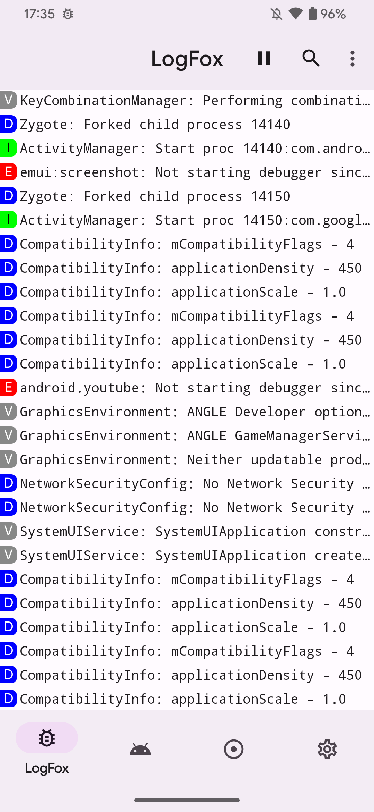
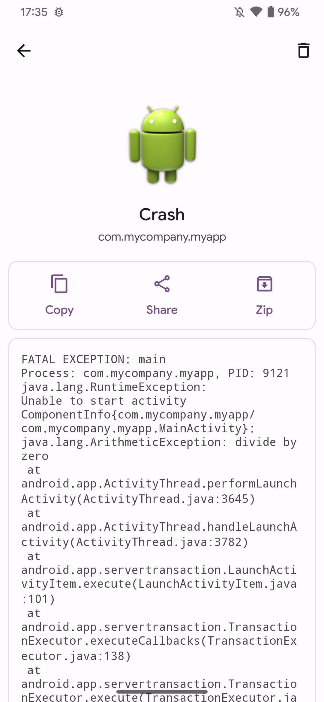
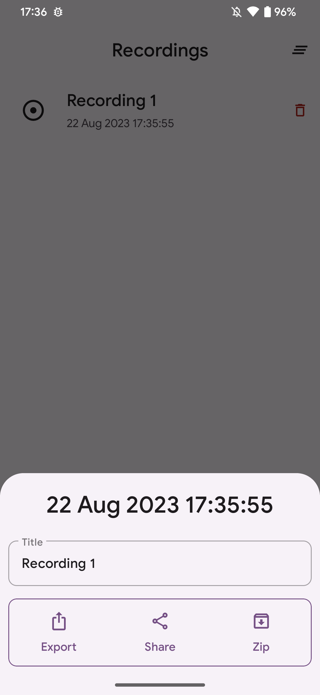
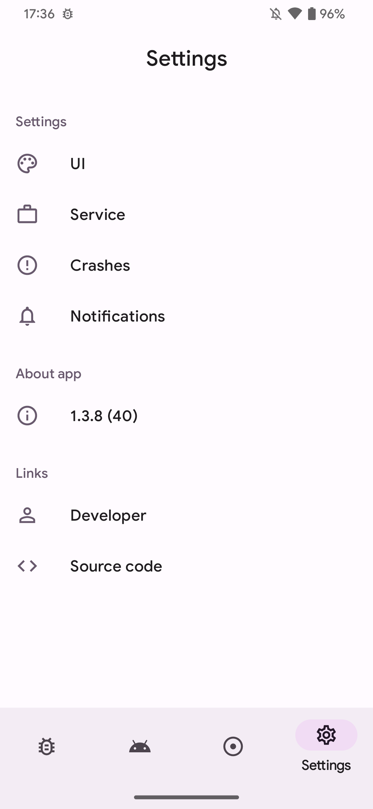
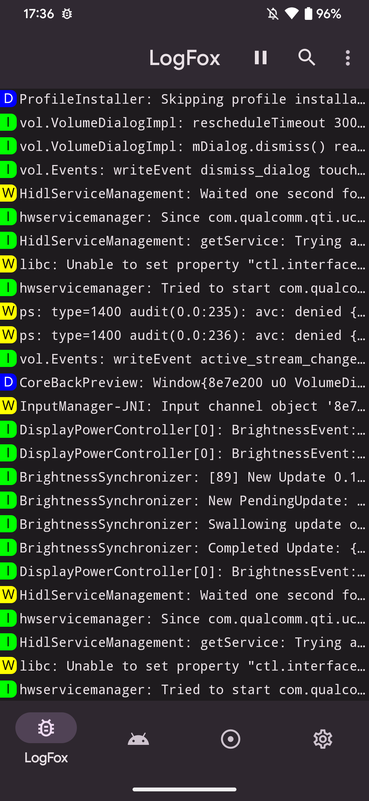

[简体中文](./README.md) · **English**

# LogFox


Yet another LogCat reader for Android

> This repository is a modified build of LogFox: it keeps the original Material You interface and adds a local **MCP service** for AI-assisted debugging, exposing structured logs, crashes/ANRs, and app/process/device information to AI. It returns text/JSON only — no screenshots, no simulated touches. The package name is `com.f0x1d.logfox.ai`, so it can be installed alongside the original LogFox.

[](./LICENSE)
[](https://github.com/F0x1d/LogFox/releases/latest)
[](https://github.com/F0x1d/LogFox/releases/latest)

## Features

- [Shizuku](https://shizuku.rikka.app/), Root & ADB support
- Record logs and export to ZIP with device info
- Observe and get notifications about Java/JNI crashes and ANRs
- Powerful filters for logs
- Accessibility support
- Material You design

## Download

<a href="https://f-droid.org/packages/com.f0x1d.logfox">
    
</a>

## Screenshots

<p align="center">
  
  
  
  
  
</p>

## LogFox AI (MCP Debugging)

### Features

- Local MCP (JSON-RPC 2.0 over HTTP), listening on `127.0.0.1:18923` by default, with no network access
- Returns text/JSON only: **no screenshots, no simulated touches**
- Structured logs: filter by `package` / `pid` / `tag` / level / keyword / regex
- Crashes: the LogFox crash database (Java/JNI/ANR) plus the system crash buffer, parsed into package name, PID, exception and stack trace
- App/process/device information; `dumpsys` allowlist; one-click diagnostic bundle
- Settings page: `Settings → AI Debugging`

### Usage

1. Install `com.f0x1d.logfox.ai`
2. Open `Settings → AI Debugging → Terminal and log permissions` and grant **Shizuku** (recommended, already available in LogFox), or grant the app `READ_LOGS`
3. Enable "Enable MCP service" and confirm the status shows "Running"
4. Add an HTTP server in your MCP client: `http://127.0.0.1:18923/mcp` (Streamable HTTP)

### MCP Tools

`status` `device_info` `apps_list` `app_info` `processes`
`logs_dump` `logs_wait` `log_stats`
`crashes_list` `crash_detail` `crash_buffer` `crash_watch`
`debug_report` `dumpsys` `batch` `help`

Recommended debugging workflow:

```
app_info → logs_dump(level=W/E) → crash_buffer / crashes_list
        → crash_detail → dumpsys
```

Use `crash_watch` when reproducing a crash; use `debug_report` when you need everything in one go.

### Build

The repository includes GitHub Actions (`.github/workflows/build-ai.yml`):

- Actions → `Build LogFox AI` → Run workflow
- Download `logfox-ai-debug` from Artifacts once the build finishes

Local build (JDK 21 + Android SDK 36):

```bash
./gradlew :app:assembleDebug
```

### Security

- MCP binds to `127.0.0.1` only and uploads no data
- Logs and process information may contain sensitive content; only use them with trusted MCP clients
- The service has no authentication by default; turn it off in settings when you don't need it

## License

```txt
Copyright (C) 2022-2026 Maksim Zoteev

This program is free software: you can redistribute it and/or modify
it under the terms of the GNU General Public License as published by
the Free Software Foundation, either version 3 of the License, or
(at your option) any later version.

This program is distributed in the hope that it will be useful,
but WITHOUT ANY WARRANTY; without even the implied warranty of
MERCHANTABILITY or FITNESS FOR A PARTICULAR PURPOSE.  See the
GNU General Public License for more details.

You should have received a copy of the GNU General Public License
along with this program.  If not, see <https://www.gnu.org/licenses/>.
```
