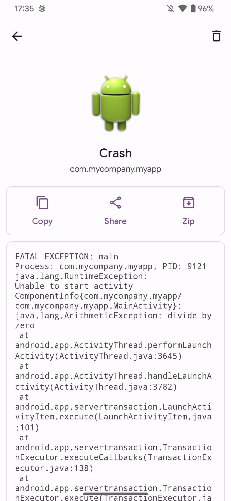
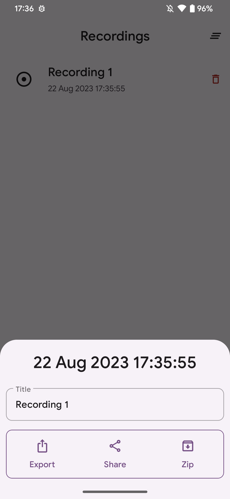

**简体中文** · [English](./README.en.md)

# LogFox


Android 上又一个 LogCat 阅读器

> 本仓库是 LogFox 的改造版：保留原有 Material You 界面，新增面向 AI 调试的本地 **MCP 服务**，向 AI 提供结构化日志、崩溃/ANR、应用/进程/设备信息。只返回文本/JSON，不传截图，不模拟触控。包名为 `com.f0x1d.logfox.ai`，可与原版 LogFox 共存。

[](./LICENSE)
[](https://github.com/F0x1d/LogFox/releases/latest)
[](https://github.com/F0x1d/LogFox/releases/latest)

## 功能

- 支持 [Shizuku](https://shizuku.rikka.app/)、Root 和 ADB
- 录制日志并导出为 ZIP（附带设备信息）
- 监听 Java/JNI 崩溃与 ANR，并发送通知
- 强大的日志过滤器
- 无障碍支持
- Material You 设计

## 下载

<a href="https://f-droid.org/packages/com.f0x1d.logfox">
    
</a>

## 截图

<p align="center">
  
  
  
  
  
</p>

## LogFox AI（MCP 调试）

### 功能

- 本地 MCP（JSON-RPC 2.0 over HTTP），默认监听 `127.0.0.1:18923`，不联网
- 只返回文本/JSON：**不截图、不模拟触控**
- 结构化日志：`package` / `pid` / `tag` / 级别 / 关键字 / 正则过滤
- 崩溃：LogFox 崩溃库（Java/JNI/ANR）+ 系统 crash buffer，解析出包名、PID、异常、堆栈
- 应用/进程/设备信息；`dumpsys` 白名单；一键诊断包
- 设置页：`设置 → AI 调试`

### 使用

1. 安装 `com.f0x1d.logfox.ai`
2. 打开 `设置 → AI 调试 → 终端与日志权限`，授权 **Shizuku**（推荐，LogFox 已有）或给应用 `READ_LOGS`
3. 打开「启用 MCP 服务」，确认状态「运行中」
4. 在 MCP 客户端里添加 HTTP 服务：`http://127.0.0.1:18923/mcp`（Streamable HTTP）

### MCP 工具

`status` `device_info` `apps_list` `app_info` `processes`
`logs_dump` `logs_wait` `log_stats`
`crashes_list` `crash_detail` `crash_buffer` `crash_watch`
`debug_report` `dumpsys` `batch` `help`

推荐调试流程：

```
app_info → logs_dump(level=W/E) → crash_buffer / crashes_list
        → crash_detail → dumpsys
```

复现崩溃时用 `crash_watch`；需要一次拿全量时用 `debug_report`。

### 构建

仓库自带 GitHub Actions（`.github/workflows/build-ai.yml`）：

- Actions → `Build LogFox AI` → Run workflow
- 构建完成后在 Artifacts 下载 `logfox-ai-debug`

本地构建（JDK 21 + Android SDK 36）：

```bash
./gradlew :app:assembleDebug
```

### 安全

- MCP 只绑定 `127.0.0.1`，不上传数据
- 日志/进程信息可能包含敏感内容，请只在可信的 MCP 客户端中使用
- 服务默认无鉴权；不需要时在设置里关闭

## 许可

```txt
Copyright (C) 2022-2026 Maksim Zoteev

This program is free software: you can redistribute it and/or modify
it under the terms of the GNU General Public License as published by
the Free Software Foundation, either version 3 of the License, or
(at your option) any later version.

This program is distributed in the hope that it will be useful,
but WITHOUT ANY WARRANTY; without even the implied warranty of
MERCHANTABILITY or FITNESS FOR A PARTICULAR PURPOSE.  See the
GNU General Public License for more details.

You should have received a copy of the GNU General Public License
along with this program.  If not, see <https://www.gnu.org/licenses/>.
```
