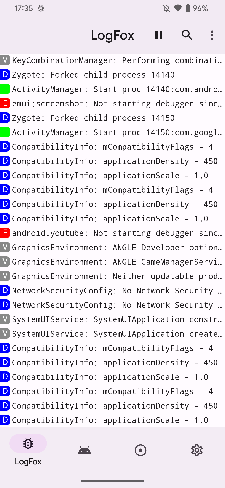
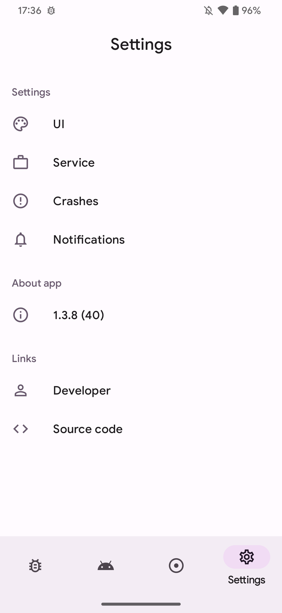
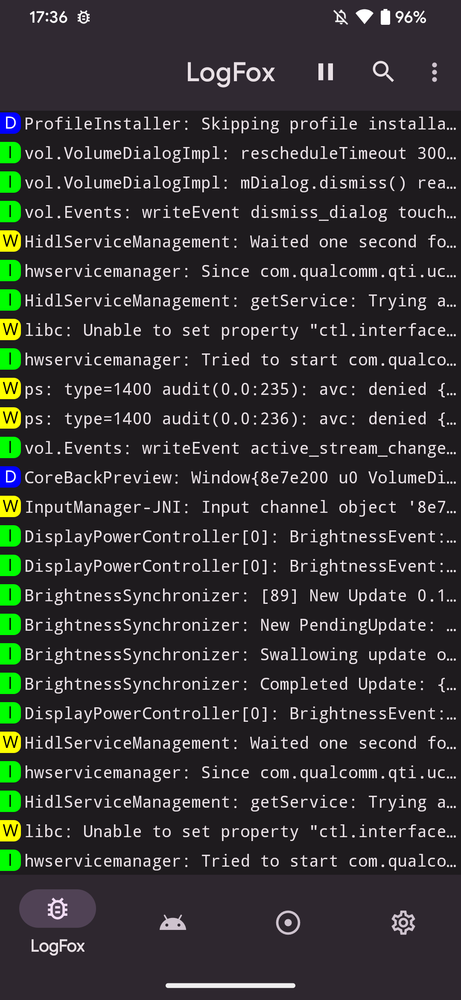

# LogFox


Yet another LogCat reader for Android

> 本仓库是 LogFox 的改造版：保留原有 Material You 界面，新增本地 **MCP 服务** 与 **无障碍触控**，让 AI 可以像人一样观察、点击、滑动、输入。包名为 `com.f0x1d.logfox.ai`，可与原版 LogFox 共存。

[](./LICENSE)
[](https://github.com/F0x1d/LogFox/releases/latest)
[](https://github.com/F0x1d/LogFox/releases/latest)

## Features

- [Shizuku](https://shizuku.rikka.app/), Root & ADB support
- Record logs and export to ZIP with device info
- Observe and get notifications about Java/JNI crashes and ANRs
- Powerful filters for logs
- Accessibility support
- Material You design

## Download

<a href="https://f-droid.org/packages/com.f0x1d.logfox">
    
</a>

## Screenshots

<p align="center">
  
  
  
  
  
</p>

## LogFox AI（MCP）

### 功能

- 本地 MCP（JSON-RPC 2.0 over HTTP），默认监听 `127.0.0.1:18923`，不联网
- 无障碍触控：点击、长按、滑动、多指手势、滚动、输入、返回/主页/最近任务、启动应用、截图、唤醒
- AI 友好能力：`observe` 一次返回界面摘要 + 可点元素 + 可选截图；`ref` 定位；`wait_for` / `wait_idle`；`batch` 多步执行；`logcat`
- 设置页：`设置 → AI 与 MCP`，可开关服务、改端口、复制地址、查看工具与调用记录

### 使用

1. 安装 `com.f0x1d.logfox.ai`
2. 打开 `设置 → AI 与 MCP`，点「无障碍服务」并按系统提示开启
3. 打开「启用 MCP 服务」，确认状态显示「运行中」
4. 在 MCP 客户端里添加 HTTP 服务：`http://127.0.0.1:18923/mcp`（Streamable HTTP）

### MCP 工具

`status` `observe` `ui_dump` `find` `tap` `tap_ref` `tap_text` `long_press` `swipe`
`gesture` `scroll` `key` `text` `open_app` `list_apps` `screenshot` `wait_for`
`wait_idle` `clipboard` `wake` `toast` `batch` `logcat` `help`

推荐给 AI 的调用顺序：

```
observe → tap_ref / tap_text / swipe / text → wait_idle 或 wait_for → observe
```

`ref` 只在最近一次 `observe` / `ui_dump` / `find` 之后有效；坐标是物理像素；截图默认缩放到 0.5。

### 构建

仓库自带 GitHub Actions（`.github/workflows/build-ai.yml`）：

- 打开 Actions → `Build LogFox AI` → Run workflow
- 构建完成后在 Artifacts 下载 `logfox-ai-debug`

本地构建（Linux/macOS，JDK 21 + Android SDK 36）：

```bash
./gradlew :app:assembleDebug
```

ARM64 Linux 主机需要把 aapt2/aidl 换成原生版本，可参考 `arm64-tools` 或 AndroidIDE 的方案。

### 安全

- MCP 只绑定 `127.0.0.1`，不会上传任何数据
- 无障碍服务能读取屏幕内容并模拟操作，请只在可信的 MCP 客户端中使用
- 服务默认无鉴权；不需要时在设置里关闭

## License

```txt
Copyright (C) 2022-2026 Maksim Zoteev

This program is free software: you can redistribute it and/or modify
it under the terms of the GNU General Public License as published by
the Free Software Foundation, either version 3 of the License, or
(at your option) any later version.

This program is distributed in the hope that it will be useful,
but WITHOUT ANY WARRANTY; without even the implied warranty of
MERCHANTABILITY or FITNESS FOR A PARTICULAR PURPOSE.  See the
GNU General Public License for more details.

You should have received a copy of the GNU General Public License
along with this program.  If not, see <https://www.gnu.org/licenses/>.
```
